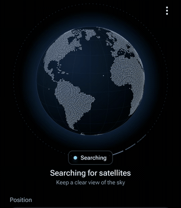
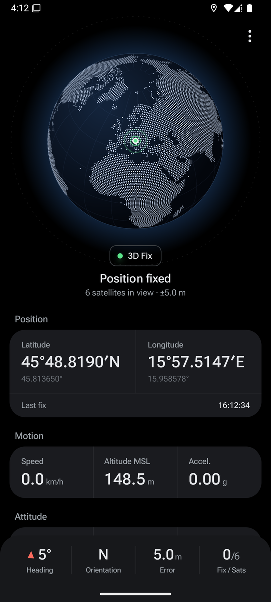
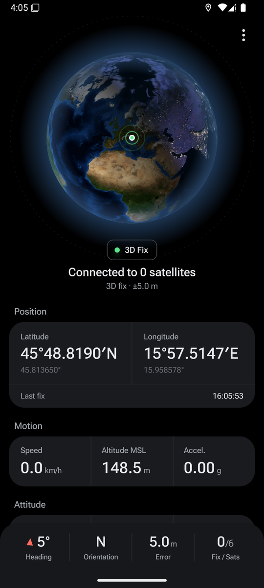
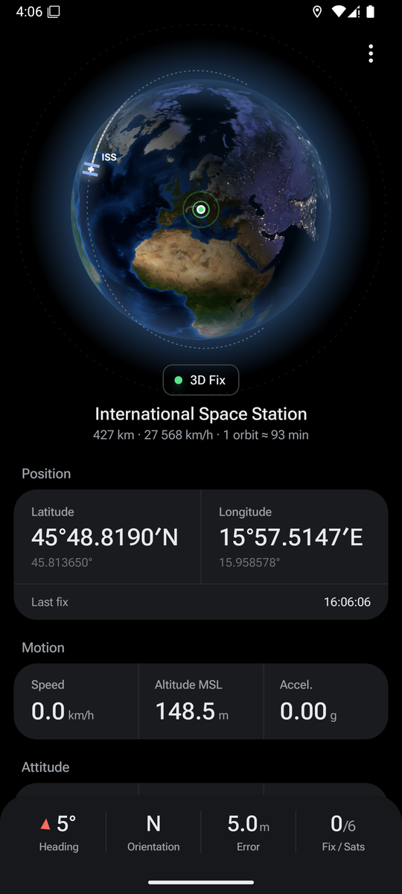
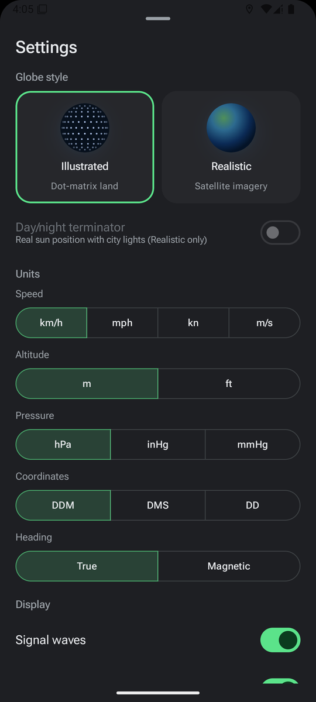

# Zenit

Real-time GNSS satellite visualisation for Android. Zenit shows your position on a 3D globe together with the navigation satellites your phone is actually tracking. Each satellite sits at its real orbital position, computed with SGP4 from CelesTrak elements.

<p align="center">
  
</p>

| Illustrated globe | Realistic globe with day/night | ISS easter egg | Settings |
|---|---|---|---|
|  |  |  |  |

<sub>Screenshots are from the Android emulator. It reports satellites without "used in fix" flags, so it shows no signal waves. On a real phone, used satellites glow and send waves towards your position.</sub>

## Download

**[Latest APK from GitHub Releases](https://github.com/divanguz-alt/zenit/releases/latest)**

Each release has `zenit-vX.Y.Z.apk` and a matching `.sha256` checksum. Zenit can also update itself: ⋮ → Settings → **Check for updates**.

Requires **Android 8.0 (API 26) or newer** with OpenGL ES 3.0.

## Features

- **Live GNSS fix** from the GPS provider at 1 Hz: latitude/longitude (DDM, DMS or decimal), accuracy, speed, bearing, and MSL altitude. MSL comes from `AltitudeConverter` on Android 14+ and from NMEA `GGA` on older versions.
- **Satellite status** for GPS, Galileo, GLONASS, BeiDou, QZSS, SBAS and NavIC: C/N0 bar chart grouped by constellation, used vs. unused, L1/L5 band, Fix/Sats counter. HDOP/PDOP/VDOP and the fix type come from NMEA `GSA`.
- **Real satellite positions.** A Kotlin port of SGP4/SDP4 propagates CelesTrak OMM elements; positions go TEME → ECEF (GMST) → geodetic and topocentric az/el. Satellites reported by the receiver are matched to catalogue objects by PRN (GPS, BeiDou) or by geometry (Galileo, GLONASS), within 6°.
- **3D globe in OpenGL ES 3.0**, in two styles you can switch live:
  - *Illustrated*: dot-matrix land generated from Natural Earth, graticule and atmosphere glow.
  - *Realistic*: NASA Blue Marble texture with lighting and an atmospheric rim. An optional real **day/night terminator** uses NASA Black Marble city lights.
- **Animations** from the design prototype: a spinning search with a scanning sky shell, a shortest-path lock onto your location, staggered satellite reveal, and signal waves from used satellites. The system "Remove animations" setting is respected.
- **ISS easter egg**: tap the globe to show the International Space Station at its real SGP4 position, with its orbit, a glowing trail, altitude and speed. Optional time-lapse.
- **Sensors**: heading (true or magnetic, with optional GPS bearing above 2 km/h), 16-point orientation, pitch/roll, rotation rate, linear acceleration, magnetic field (horizontal/total) with declination, barometric pressure with a 15-minute trend, and today's steps. Missing sensors show "—".
- **Units**: km/h · mph · kn · m/s, m · ft, hPa · inHg · mmHg.
- **Display options**: show all constellation satellites, true-scale orbits, signal waves, unused satellites, keep screen on.
- **Works offline** with the last downloaded orbits and shows how old they are. With no orbital data at all, satellites are placed from the receiver's az/el.
- **Debug view** (⋮ → long-press the version): predicted vs. measured az/el for each matched satellite.

## Data sources and attributions

| Data | Source | License |
|---|---|---|
| Earth texture | NASA Visible Earth, *Blue Marble: Next Generation* (Reto Stöckli, NASA Earth Observatory) | Public domain |
| City lights | NASA Earth Observatory, *Earth at Night (Black Marble) 2016* | Public domain |
| Land mask | [Natural Earth](https://www.naturalearthdata.com/) `ne_50m_land` | Public domain |
| Orbital elements | [CelesTrak](https://celestrak.org/) GP data (OMM JSON), Dr. T.S. Kelso | Free use under CelesTrak's usage policy |
| SGP4/SDP4 | Ported from [satellite.js](https://github.com/shashwatak/satellite-js), itself based on David Vallado's reference code | MIT |
| Font | [Roboto Flex](https://fonts.google.com/specimen/Roboto+Flex) | SIL OFL 1.1 |

Zenit downloads the `gps-ops`, `galileo`, `glo-ops`, `beidou` and `sbas` groups, plus the ISS (`CATNR=25544`). A WorkManager job refreshes them once a day when the network is available, and never more than once every two hours per group, as CelesTrak asks.

## Permissions

| Permission | Why |
|---|---|
| `ACCESS_FINE_LOCATION`, `ACCESS_COARSE_LOCATION` | GNSS fix, satellite status and NMEA. Requested with an explanation first. There is no background location. |
| `ACTIVITY_RECOGNITION` | Step counter. Requested only when you tap the Steps card. |
| `INTERNET`, `ACCESS_NETWORK_STATE` | Downloading orbital elements and checking GitHub for updates. |
| `REQUEST_INSTALL_PACKAGES` | Installing an update you downloaded from inside the app. |
| `HIGH_SAMPLING_RATE_SENSORS` | Optional: smoother sensor readings on Android 12+. |

Your location never leaves the device. See [PRIVACY.md](PRIVACY.md).

## Building

Requirements: JDK 17 and the Android SDK (platform 35, build-tools 35+).

```bash
./gradlew assembleDebug
```

Run the tests:

```bash
./gradlew testDebugUnitTest
```

```bash
./gradlew connectedDebugAndroidTest
```

The unit tests check the SGP4 port against Vallado's `SGP4-VER.TLE` vectors (666 states, under 1 mm), compare the full orbit chain against python-sgp4 on real GPS elements, and cover coordinate formatting, units, SemVer, satellite matching and NMEA parsing. Compose UI tests cover settings and unit switching.

### Bundled assets

The land dots, Earth textures and font are committed so the build works offline. To regenerate them from the original sources:

```bash
pip install pillow
```

```bash
python3 tools/prepare_assets.py --preview
```

The script downloads Natural Earth 50m land, Blue Marble and Black Marble, and Roboto Flex. It writes:

- `app/src/main/assets/land_dots.bin`: float32 lat/lon pairs on 1.2° rows with equal-area spacing. Rings that cross the antimeridian (Russia, Fiji, Antarctica) are unwrapped and closed through the pole.
- `app/src/main/assets/earth_day.jpg` (4096×2048) and `earth_night.jpg` (2048×1024).
- `app/src/main/res/font/roboto_flex.ttf`.

### Release signing

Release builds are signed in CI. Pushing a `vX.Y.Z` tag runs `.github/workflows/release.yml`, which:

1. builds `assembleRelease` with the version taken from the tag;
2. signs it with the keystore from the repository secrets `KEYSTORE_B64`, `KEYSTORE_PASSWORD`, `KEY_ALIAS` and `KEY_PASSWORD`;
3. computes the SHA-256;
4. publishes a GitHub Release with `zenit-vX.Y.Z.apk`, `zenit-vX.Y.Z.apk.sha256` and the matching `CHANGELOG.md` section as release notes.

To build a signed release locally, point `ZENIT_SIGNING_PROPS` at a `keystore.properties` file kept outside the repository. It needs `storeFile`, `storePassword`, `keyAlias` and `keyPassword`.

## License

[MIT](LICENSE) © 2026 divanguz-alt
